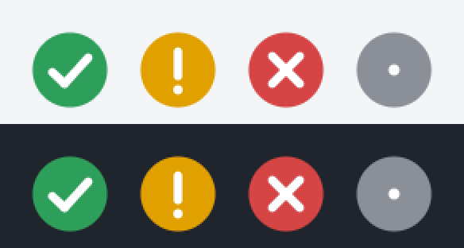

# The page in the browser

`backupclaude ui` is for the person who does not want to open a command line. It starts a small page on your computer, opens it in the default browser, and ends when you close the tab. Nothing stays running in the background.


## What is on the page

| Tab | What it shows and does |
| --- | --- |
| **State** | The first screen answers one question: is the data safe or is action needed. Under it: how long ago each copy was updated, size, free space on the disks, the last repository check and the last trial restore, failed tasks, the scheduled tasks as Windows holds them. The **Save now** button takes a snapshot of Claude's data and of the projects at once. An external copy that is not set up is said so plainly |
| **Snapshots** | Every snapshot, newest first, with the number of files and the size; filter by Claude data or projects |
| **Restore** | Pick a session (a session missing on this computer is marked *only in the copy*) or a project. **Take out into a separate folder** is the safe way: the files are laid out in a new folder and nothing on the computer changes. **Put back in place** first shows what would happen, and only a confirmation in a separate window does it. Only missing files come back; a file that exists is never overwritten |
| **Settings** | Where the copies are, the schedule, whether the password is stored (the page never shows it), notification channels. Changeable: language, how many snapshots to keep, the threshold of the alarm about deleted sessions, extra folders to save, folders not to save, the status icon |


## How it works

The page holds no logic of its own. Every button runs the same code as the command of the same name and shows its `--json` answer: **State** is `status`, **Save now** is `backup`, **Snapshots** and the lists of sessions and projects are `list`, **Restore** is `restore` (`--apply --dry-run` for the preview, `--apply` for putting back), the scheduled tasks are `schedule status`. All texts come from the catalogs of the program, so the page speaks English or Russian like the commands do.

The page is part of the program file (`go:embed`) and needs neither the internet nor Node. It loads nothing from other sites.

## Security

- The server listens on `127.0.0.1` only, on a random port chosen at each start. Other computers cannot reach it.
- The link printed by the command holds a **one-time token**. The first request with it receives a session cookie (not readable by scripts of the page, not sent from other sites) and is sent on to the page without the token in its address. The same link a second time is refused.
- Every request must come with exactly the address the server listens on (`Host`), which stops a hostile site from reaching the page through its own name that points to your computer. A request that carries another `Origin`, or a change without the marker header of the page, is refused.
- The page can run only a fixed list of commands (`status`, `list`, `backup`, `restore`, `schedule status`, `password` without `--show`). Names of sessions and projects are checked and always passed behind `--name=`, so they cannot become options.
- **The password is never shown.** The page learns only whether it is stored. Writing it on paper is still done in a terminal: `backupclaude password --show`.
- Putting files back in place works in two steps. The preview gives a receipt that is valid for exactly that session or project, for half an hour and once; the second step needs the receipt and your confirmation. A request without them is refused by the server, not only by the page.
- Closing the tab ends the server a few seconds later. The page keeps one connection open while it is open, so even a tab in the background keeps it alive. If a save is running when the tab is closed, the server waits for it to end. If nobody opens the link within three minutes, the server ends. Ctrl+C in the window of the command ends it at once and stops what is running.

## Options

```
backupclaude ui              open the page in the default browser
backupclaude ui --no-open    do not open the browser, only print the link
backupclaude ui --json       print the link as JSON (one object, at the start)
```

If the browser cannot be opened the command prints the link; open it yourself, once.

## The icon in the notification area



`backupclaude tray` (Windows) shows a small icon whose colour and sign tell the state: a green tick, a yellow exclamation mark, a red cross, a grey dot while the state is being read or cannot be read. A click opens the page; the menu has **Open the page**, **Check again** and **Quit**. The state is read every ten minutes by the same code as `status`.

The icon is **off by default**, because it is a program that stays running. To have it at every login, tick it on the **Settings** tab, or run `backupclaude tray --enable`; `--disable` and the same tick turn it off. Switching it on adds one entry to the user's startup list (no administrator rights) and shows the icon at once. An icon that is shown stays until you choose **Quit** in its menu.

## If something goes wrong

- *The page says the link was used already.* A link works once. Start `backupclaude ui` again.
- *The browser did not open.* Open the link printed in the window.
- *The page is blank or says "no answer from the program".* The program ended, usually because the tab was closed. Start it again.
- *The State tab shows red badges next to the scheduled tasks.* The tasks were set up for another copy of the program file than the one that opened the page. Run `backupclaude schedule install` from the program you use.
