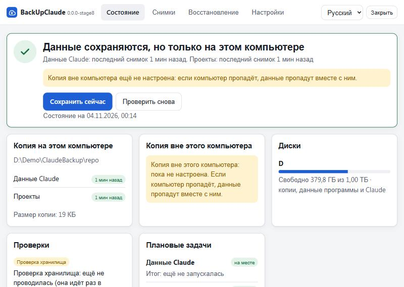
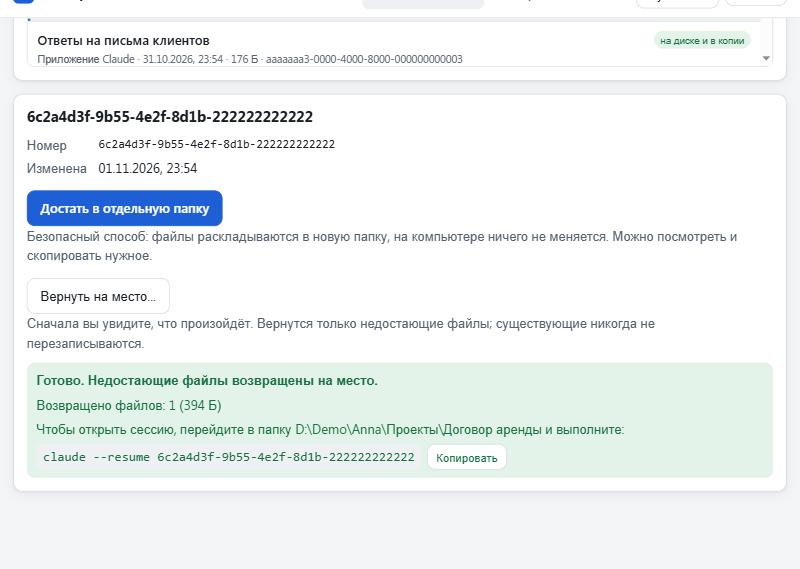
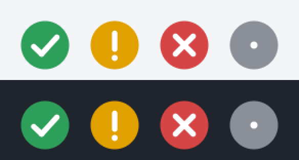

# Страница в браузере

`backupclaude ui` для тех, кто не хочет открывать командную строку. Команда запускает на вашем компьютере небольшую страницу, открывает её в браузере по умолчанию и завершается, когда вы закрываете вкладку. В фоне ничего не остаётся.



## Что есть на странице

| Вкладка | Что показывает и делает |
| --- | --- |
| **Состояние** | Первый экран отвечает на один вопрос: данные в безопасности или нужно действие. Ниже: сколько времени назад обновлялась каждая копия, объём, свободное место на дисках, последняя проверка хранилища и последнее пробное восстановление, упавшие задачи, плановые задачи в том виде, как их хранит Windows. Кнопка **Сохранить сейчас** сразу делает снимок данных Claude и проектов. Если внешняя копия не настроена, об этом сказано прямо |
| **Снимки** | Все снимки, сначала новые, с числом файлов и объёмом; фильтр по данным Claude и проектам |
| **Восстановление** | Выберите сессию (сессия, которой на этом компьютере нет, помечена *только в копии*) или проект. **Достать в отдельную папку** это безопасный способ: файлы раскладываются в новую папку, на компьютере ничего не меняется. **Вернуть на место** сначала показывает, что произойдёт, и делает это только после подтверждения в отдельном окне. Возвращаются только недостающие файлы; существующий файл не перезаписывается никогда |
| **Настройки** | Где лежат копии, расписание, хранится ли пароль (сам пароль страница не показывает), каналы уведомлений. Можно изменить: что сохранять (данные Claude, папки проектов; действует сразу, добавляет или убирает задачу в планировщике), язык, сколько снимков хранить, порог тревоги об удалённых сессиях, дополнительные папки для копии, папки, которые не сохранять, значок в области уведомлений |



Другие экраны: [снимки](screenshots/snapshots-light.jpg), [подтверждение перед возвратом](screenshots/restore-confirm-light.jpg), [настройки](screenshots/settings-light.jpg), [проблема на вкладке «Состояние»](screenshots/state-problem-light.jpg) и тёмная тема на ширине телефона ([Состояние](screenshots/state-dark-mobile.jpg), [Восстановление](screenshots/restore-dark-mobile.jpg)). Снимки сделаны на выдуманных данных.

## Как это устроено

В самой странице нет логики. Каждая кнопка запускает тот же код, что и одноимённая команда, и показывает её ответ `--json`: **Состояние** это `status`, **Сохранить сейчас** это `backup`, **Снимки** и списки сессий и проектов это `list`, **Восстановление** это `restore` (`--apply --dry-run` для просмотра, `--apply` для возврата), плановые задачи это `schedule status`. Все тексты берутся из каталогов программы, поэтому страница говорит по-русски или по-английски так же, как команды.

Страница встроена в сам файл программы (`go:embed`) и не требует ни интернета, ни Node. С других сайтов она ничего не загружает.

## Безопасность

- Сервер слушает только `127.0.0.1` и случайный порт, который выбирается при каждом запуске. Другие компьютеры до него не достучатся.
- В ссылке, которую печатает команда, лежит **разовый токен**. Первый запрос с ним получает сессионный cookie (его не читают скрипты страницы и не отправляют с других сайтов) и перенаправляется на страницу без токена в адресе. Та же ссылка во второй раз отклоняется.
- Каждый запрос должен прийти ровно на тот адрес, который слушает сервер (`Host`): так чужой сайт не доберётся до страницы через своё имя, указывающее на ваш компьютер. Запрос с чужим `Origin` и любое изменение без служебного заголовка страницы отклоняются.
- Страница может выполнить только заданный список команд (`status`, `list`, `backup`, `restore`, `schedule status`, `password` без `--show`). Имена сессий и проектов проверяются и всегда передаются в виде `--имя=значение`, поэтому стать параметрами не могут.
- **Пароль страница не показывает никогда.** Она узнаёт только, хранится ли он. Записать его на бумагу по-прежнему можно в терминале: `backupclaude password --show`.
- Возврат файлов на место идёт в два шага. Просмотр выдаёт квитанцию, которая действует ровно для этой сессии или проекта, полчаса и один раз; второй шаг требует квитанцию и ваше подтверждение. Запрос без них отклоняет сервер, а не только страница.
- После закрытия вкладки сервер завершается через несколько секунд. Пока страница открыта, она держит одно соединение, поэтому даже вкладка в фоне не даёт серверу уйти. Если в момент закрытия идёт сохранение, сервер дожидается его конца. Если ссылку никто не открыл за три минуты, сервер завершается. Ctrl+C в окне команды завершает его сразу и останавливает то, что выполняется.

## Параметры

```
backupclaude ui              открыть страницу в браузере по умолчанию
backupclaude ui --no-open    не открывать браузер, только напечатать ссылку
backupclaude ui --json       напечатать ссылку в JSON (один объект, в начале)
```

Если браузер открыть не удалось, команда печатает ссылку: откройте её сами, один раз.

## Значок в области уведомлений



`backupclaude tray` (Windows) показывает небольшой значок, цвет и знак которого говорят о состоянии: зелёная галочка, жёлтый восклицательный знак, красный крест, серая точка, пока состояние читается или прочитать его не удалось. Щелчок открывает страницу; в меню **Открыть страницу**, **Проверить снова** и **Выход**. Состояние читается раз в десять минут тем же кодом, что и `status`.

По умолчанию значок **выключен**, потому что это программа, которая остаётся работать. Чтобы он появлялся при каждом входе в систему, отметьте его на вкладке **Настройки** или выполните `backupclaude tray --enable`; `--disable` и та же отметка выключают его. Включение добавляет одну запись в список автозапуска пользователя (права администратора не нужны) и сразу показывает значок. Показанный значок остаётся, пока вы не выберете **Выход** в его меню.

## Если что-то не так

- *Страница пишет, что ссылка уже использована.* Ссылка работает один раз. Запустите `backupclaude ui` заново.
- *Браузер не открылся.* Откройте ссылку, напечатанную в окне.
- *Страница пустая или пишет «нет ответа от программы».* Программа завершилась, обычно из-за закрытой вкладки. Запустите её снова.
- *Рядом с плановыми задачами на вкладке «Состояние» красные метки.* Задачи настроены на другой файл программы, не тот, что открыл страницу. Выполните `backupclaude schedule install` из той программы, которой пользуетесь.
